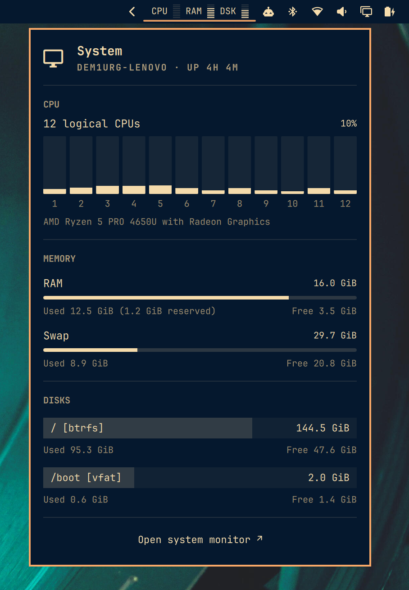

# System Meters for Omarchy

A compact CPU, RAM and disk widget with a detailed system panel for Omarchy Quattro.

<p align="center">
  
</p>

## Features

- CPU, RAM and system filesystem usage in the bar.
- Horizontal bars use segmented meters; vertical bars use compact tracks.
- Click to open a panel with per-logical-CPU activity, RAM and swap usage, and mounted filesystems.
- Used and free capacity shown in GiB, with installed RAM capacity and reserved memory when available.
- Colors and fonts follow the active Omarchy bar and theme.
- Warning colors appear in the filled portion of each meter; disk free space turns red at 90% usage.
- Escape closes the panel, Tab switches between bar panels, and Enter opens btop.
- Local statistics refreshed every two seconds. No network service or Python packages required.

## Requirements

- Omarchy Quattro with the Quickshell-based shell and its `qs.Ui` / `qs.Commons` components.
- Linux with readable `/proc` system statistics.
- Python 3 at `/usr/bin/python3` (standard library only).
- `btop` for the optional **Open system monitor** action.

Tested on Omarchy **4.0.6-1**, Hyprland, and an AMD x86-64 laptop. This is an Omarchy shell plugin; it is not a standalone Quickshell configuration or a Waybar module. Older Omarchy releases and third-party replacement bars have not been verified.

## Installation

Once this repository is public:

```bash
omarchy plugin add https://github.com/dem1urg1/omarchy-system-meters.git --enable
```

The plugin ID is **`demiurg.system-meters`**. It defaults to the right section of the bar. Change its position through Omarchy's bar settings, or run:

```bash
omarchy bar move demiurg.system-meters --section right
```

The plugin does not install packages or change other desktop settings.

### Install from a local copy

If this plugin ID is not already installed:

```bash
mkdir -p ~/.config/omarchy/plugins/demiurg.system-meters
cp manifest.json Meters.qml stats.py mounts.py \
  ~/.config/omarchy/plugins/demiurg.system-meters/
omarchy-shell shell rescanPlugins
omarchy plugin enable demiurg.system-meters --section right
```

Manual copies do not receive Git-based updates. Back up an existing local copy before replacing it.

## Usage

- Click the CPU / RAM / DSK widget to open or close its panel.
- CPU bars are numbered from 1 and show each logical processor's current activity. The percentage at the top is the overall CPU load, not a sum of core percentages.
- RAM and Swap show capacity above their meters, with **Used** and **Free** below.
- Filesystem rows show the mount point and filesystem type inside a wide usage bar, with used and free capacity below.
- Click **Open system monitor**, or press Enter while the panel is focused, to launch btop.

## How memory and storage are counted

**RAM:** available memory comes from Linux `MemAvailable`, which includes memory Linux estimates it can reclaim. Where readable udev/SMBIOS data is available, the heading shows installed physical memory. Used memory includes the difference between installed memory and Linux `MemTotal`; that difference is also shown as **reserved**. If installed capacity cannot be detected, the widget falls back to `MemTotal`.

**Swap:** the meter combines all enabled swap devices and files, including zram. This is logical swap capacity and usage; it does not represent the physical RAM consumed by compressed zram data. The Swap row is hidden when no swap is enabled.

**Filesystems:** virtual filesystems are filtered out and mount aliases are grouped by device and filesystem. These rows represent mounted filesystems, not physical drive models. Accessible external and network filesystems may also appear. **Free** is space available to an ordinary user; filesystem reservations can mean used plus free is smaller than total. Fill percentage is calculated from used plus user-available space.

All capacity figures use **GiB** (1 GiB = 1,073,741,824 bytes).

## Update, disable or remove

For an installation made with `omarchy plugin add`:

```bash
omarchy plugin update demiurg.system-meters
```

To disable or remove it:

```bash
omarchy plugin disable demiurg.system-meters
omarchy plugin remove demiurg.system-meters
```

## Development and validation

The repository root is the plugin directory:

```text
manifest.json   Plugin metadata and entry point
Meters.qml      Bar widget and details panel
stats.py        CPU, RAM, swap and system filesystem collector
mounts.py       Mounted filesystem detection and grouping
```

Validate the manifest and layout on an Omarchy installation:

```bash
omarchy plugin validate .
```

To inspect the live collector output without starting another shell:

```bash
python3 stats.py
# Ctrl+C to stop
```

`stats.py` streams one JSON object per line every two seconds. Output includes the local hostname, CPU model, capacities, and mounted device paths; review it before sharing diagnostic output.

Omarchy reloads installed user plugins when their files change. If a change is not picked up:

```bash
omarchy-shell shell rescanPlugins
```

If the shell still uses cached QML, restart it with `omarchy restart shell`.

## Credits and license

Created by **demiurg** for Omarchy. Uses the existing Omarchy shell's panel, typography and theme components. Portions of the UI follow Omarchy's built-in widgets.

Distributed under the MIT license; see [LICENSE](LICENSE), including attribution for Omarchy-derived portions.
